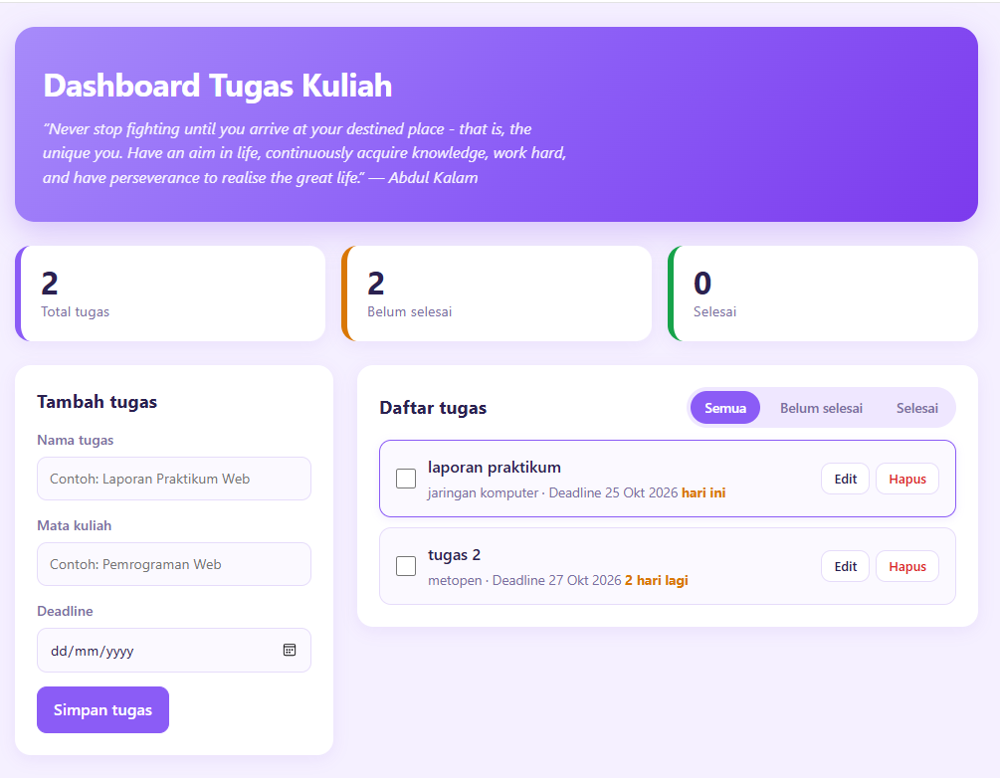

# Dashboard Daftar Tugas Kuliah

## Deskripsi
Website ini dibuat untuk membantu mahasiswa mencatat dan mengelola tugas kuliah agar lebih teratur. Website ini menggunakan HTML, CSS, dan JavaScript.

## Fitur
- Menambahkan tugas kuliah (nama tugas, mata kuliah, dan deadline).
- Menampilkan daftar tugas.
- Mengedit tugas yang sudah dibuat.
- Menandai tugas yang sudah selesai.
- Menghapus tugas.
- Memfilter tugas: semua, belum selesai, dan selesai.
- Menampilkan jumlah seluruh tugas, tugas yang belum selesai, dan tugas yang sudah selesai.
- Menampilkan penanda deadline (hari ini, sisa hari, atau terlambat).
- Menyimpan data tugas menggunakan localStorage.
- Menampilkan kutipan motivasi secara acak dari API.

## Teknologi yang Digunakan
- HTML untuk membuat struktur halaman.
- CSS untuk mengatur tampilan website.
- JavaScript untuk menjalankan fungsi website.
- LocalStorage untuk menyimpan data tugas.
- DummyJSON API untuk mengambil kutipan motivasi.

## Cara Menjalankan
1. Download atau clone repository ini.
2. Buka folder proyek di Visual Studio Code.
3. Pastikan file `index.html`, `style.css`, `main.js`, `app.js`, `utils.js`, dan `data.js` berada dalam folder yang sama.
4. Jalankan file `index.html` menggunakan ekstensi Live Server (jangan dibuka dengan double-click karena memakai `type="module"`).
5. Website siap digunakan.

## Penerapan JavaScript ES6+
- `let` dan `const` untuk membuat variabel.
- `class` untuk membuat objek tugas dan mengelola aplikasi.
- Arrow function untuk membuat fungsi.
- Template literals untuk menampilkan informasi tugas dan kutipan.
- `async/await` untuk mengambil kutipan motivasi dari API.
- Destructuring untuk mengambil data dari objek.
- Spread operator untuk memperbarui data tugas tanpa mengubah data lama.
- ES Modules (`import` dan `export`) untuk memisahkan kode ke beberapa file.
- `localStorage` untuk menyimpan data tugas.

## Referensi Baris Kode
- Deklarasi variabel (`let` dan `const`): bagian awal `main.js` dan `app.js`.
- Class `TaskItem` dan `DashboardApp`: `app.js`.
- Arrow function: `utils.js` serta fungsi `render`, `renderTask`, `resetForm`, dan `deadlineLabel` di `main.js`.
- Template literals: fungsi `renderTask` dan `render` di `main.js`.
- Async/await: fungsi `fetchQuote()` di `app.js` dan `loadExternal()` di `main.js`.
- Destructuring: `main.js` dan `app.js`, misalnya pada `const { id } = li.dataset`.
- Spread operator: method `add()`, `toggle()`, dan `update()` di `app.js`.
- LocalStorage: fungsi `save()` dan `load()` di `app.js`.

## Dokumentasi

### Tampilan Aplikasi

## Penutup
Website ini dibuat sebagai latihan penerapan JavaScript ES6+ untuk membuat halaman web interaktif sederhana yang dapat membantu mahasiswa mengelola tugas kuliah.
