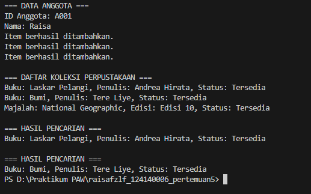

# Sistem Manajemen Perpustakaan Sederhana

## Identitas Mahasiswa

- Nama: Raisa Fazila Faisal
- NIM: 124140006
- Kelas: RB

## Deskripsi Program

Program ini merupakan sistem manajemen perpustakaan sederhana yang dibuat menggunakan bahasa pemrograman Python dengan konsep Object Oriented Programming (OOP).

Program ini dapat menyimpan data buku dan majalah, menampilkan daftar koleksi, serta mencari item berdasarkan ID atau judul.

## Konsep OOP yang Digunakan

1. **Class dan Object**

   Digunakan untuk membuat objek buku, majalah, anggota, dan perpustakaan.

2. **Inheritance**

   Class Book dan Magazine merupakan turunan dari class LibraryItem.

3. **Encapsulation**

   Menggunakan atribut protected dan private untuk menyimpan data.

4. **Polymorphism**

   Method get_detail() memiliki hasil yang berbeda pada class Book dan Magazine.

5. **Abstraction**

   Menggunakan class LibraryItem sebagai class abstrak dengan method get_detail().

## Fitur Program

- Menambahkan buku dan majalah.
- Menampilkan daftar koleksi perpustakaan.
- Mencari item berdasarkan ID.
- Mencari item berdasarkan judul.
- Menampilkan status ketersediaan item.

## Struktur File

- library_item.py : Berisi class LibraryItem, Book, dan Magazine.
- library.py : Mengelola koleksi perpustakaan.
- member.py : Menyimpan data anggota.
- main.py : Menjalankan program.

## Cara Menjalankan Program

1. Buka folder tugas melalui terminal.
2. Jalankan perintah berikut:

   ```bash
   python main.py
   ```

3. Program akan menampilkan data anggota, koleksi perpustakaan, dan hasil pencarian.

## Dokumentasi


